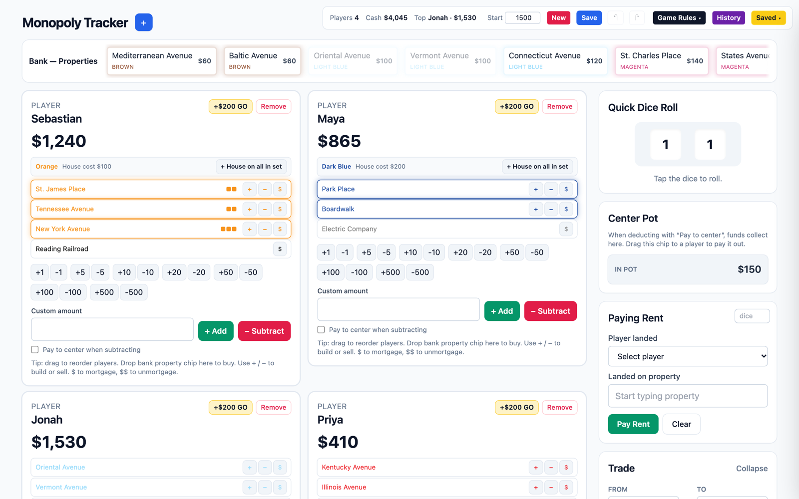

# Monopoly Tracker

A convenient dashboard for Monopoly nights. Instead of shuffling paper money, everyone's cash, properties, houses, mortgages, and the Free Parking pot live in one browser tab (with local storage to come back to ongoing games), and the app works out rent for you. Live at **[monopolytracker.com](https://www.monopolytracker.com)**.



## Features

- **Players and cash:** add, remove, and drag to reorder players. Quick +/- buttons for every bill size, custom amounts, and a one-tap "+$200 GO".
- **Buying property:** drag a property chip from the bank strip onto a player. Owned chips are dimmed so they can't be bought twice.
- **Rent calculator:** pick who landed where and the rent is computed from the full US rule set: doubled rent on an unimproved full set, 1-4 houses or a hotel, railroads by count owned, and utilities from the dice roll. Mortgaged properties collect nothing.
- **Houses and hotels:** build or sell one at a time (sales refund 50%) or add a house across a whole color set. The even-build rule is on by default and can be turned off under Game Rules.
- **Mortgages:** mortgage for 50% of the price, lift for 110%. Blocked while buildings are standing.
- **Trades:** swap properties plus optional cash in either direction.
- **Center pot:** a "Pay to center" toggle sends taxes and fees into a Free Parking pot. Drag the pot chip onto a player to pay it out.
- **Dice, history, undo/redo:** an animated two-dice roller, plus a typed transaction log that undo and redo replay.
- **Saves:** the current game autosaves on every change. Named saves keep the five most recent games.
- **Mobile layout:** below 768px the toolbar folds into a "Game controls" menu so it works on a phone at the table.

## How it's built

| Part | Tools |
|---|---|
| UI | React 19 + TypeScript, styled with Tailwind CSS |
| Build | Vite 7 |
| Storage | [Dexie](https://dexie.org) (IndexedDB) for named saves, `localStorage` for the autosave |
| Hosting | Vercel, deployed on every push to `main`, with Vercel Analytics |

There's no backend: all game state stays in the player's browser, so nobody needs an account and nothing leaves the device.

## Run it locally

```bash
cd monopoly-tracker
npm install
npm run dev
```

`npm run build` type-checks and produces a static build in `monopoly-tracker/dist/`.

## Project layout

```
monopoly-tracker/
  src/MonopolyCashTracker.tsx   # the app: board data, rent rules, player cards, panels
  src/db.ts                     # Dexie database for saved games
  src/main.tsx                  # entry point
```
